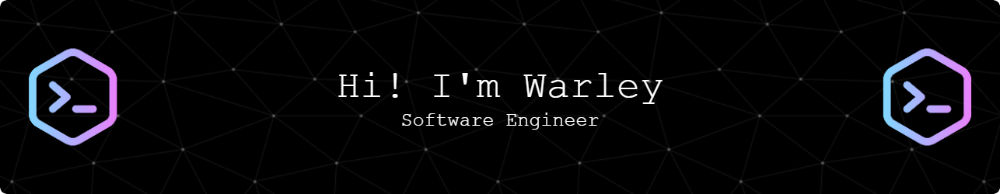

  

  

  &nbsp;
  &nbsp;
  &nbsp;
  &nbsp;
  &nbsp;
  &nbsp;
  &nbsp;
  &nbsp;
  &nbsp;
  &nbsp;
  &nbsp;
  &nbsp;
  &nbsp;
  &nbsp;
  

### :coffee: About Me :
Warley is a senior software engineer and tech lead with 10+ years of experience in the IT industry.
He has worked as an IT analyst, tech lead and software engineer with cross-functional teams, collaborating with designers, product managers and developers.

A strong team player with clear, succinct communication. He adapts quickly to new tools and problems, pays attention to the user's experience, and works to keep the team moving well together.

- :coffee: I'm currently a Senior AI Engineer at Ubiminds, contributing to backend, frontend and AI systems for enterprise applications.
> - Integrating LLM agents and production RAG pipelines with .NET backends (Python, LangChain/LangGraph, Azure and AWS).
> - Web and mobile apps in React, React Native and Angular (TypeScript/JavaScript).
> - Backend in modern .NET/C#, with SQL Server and PostgreSQL.
> - Cloud and CI/CD on Azure, AWS, Azure DevOps, GitHub Actions and Docker.
- Previously Tech Lead at Thoughtworks (embedded at AB InBev) and Lead Software Engineer at who.
- Founder of 90crafters, delivering software, automation and AI for small and mid-size businesses in up to 90 days.
- Technologist in IT Management (FIAP) and postgraduate certificate in Cloud Computing (Anhanguera).
- :lotus_position_man: In my free time, I still think about coding — watching talks and reading to keep learning.

- :phone: How to reach me:
> - :globe_with_meridians: LinkedIn: 
> - :mailbox: Mail: warleycesar10@hotmail.com

### :fire: Current Stats :

---
<!--
### :fire: Top Langs :

-->
